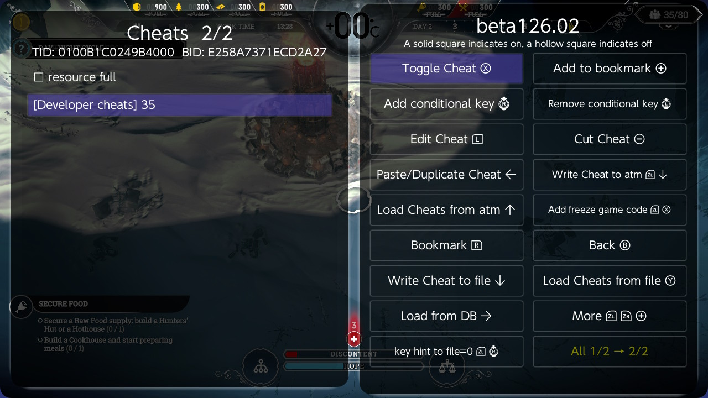
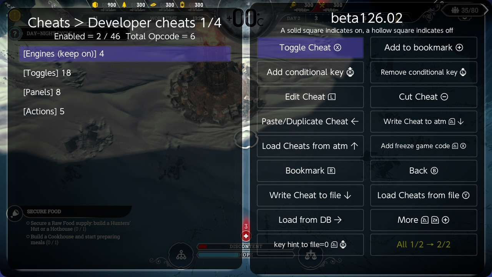
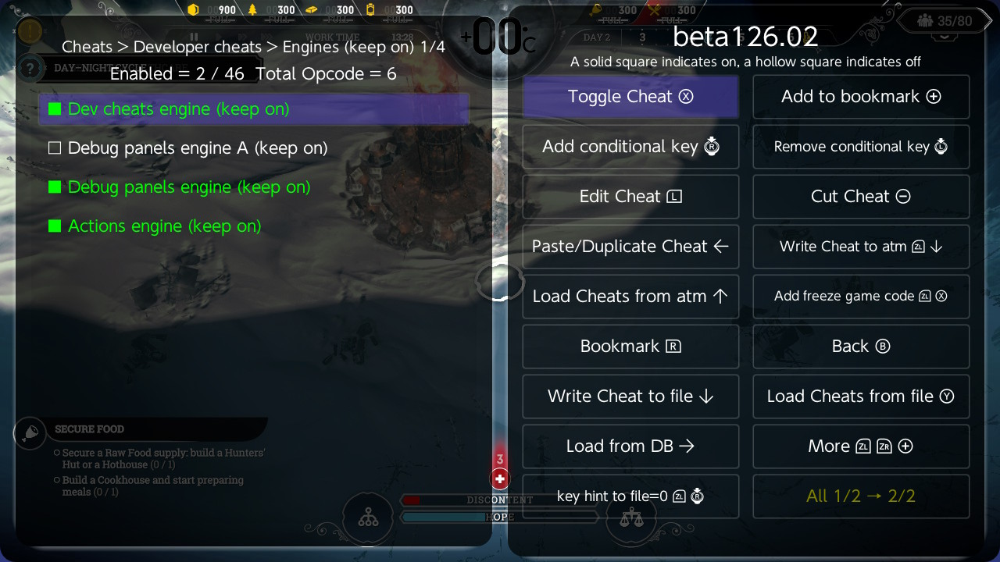
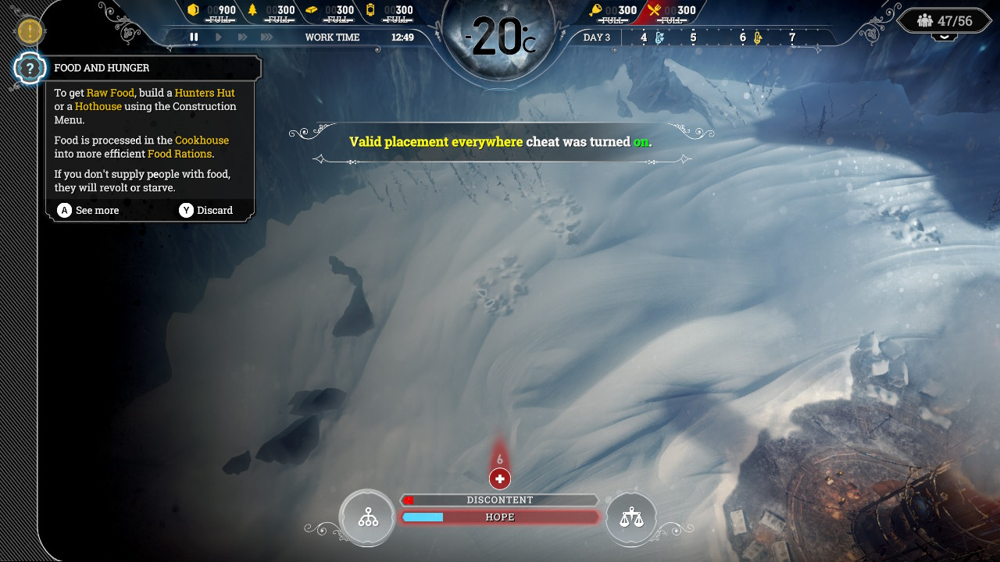
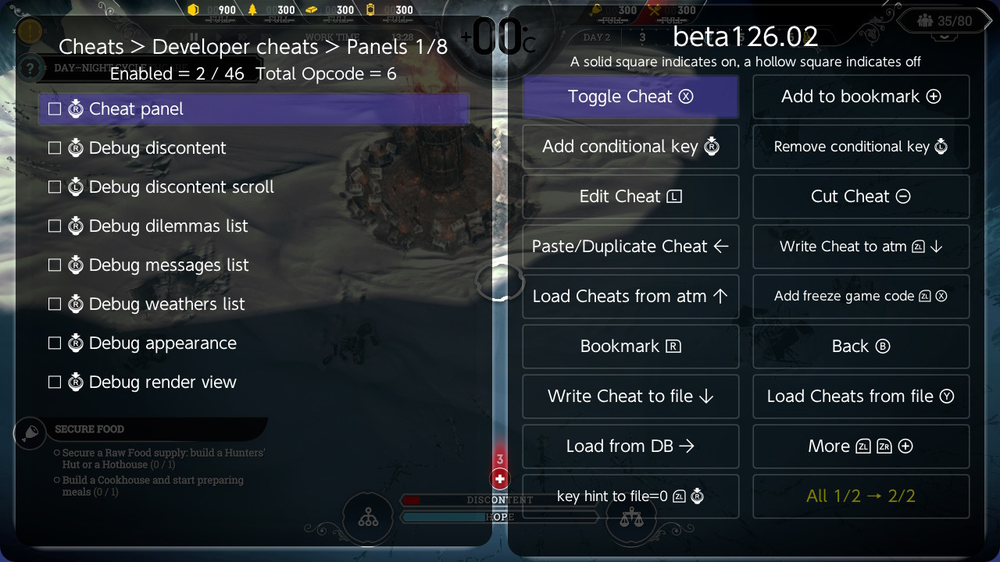
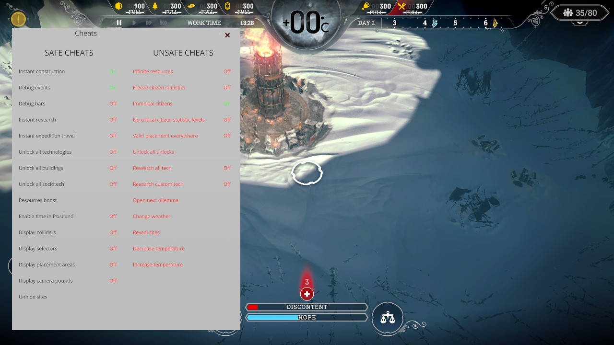
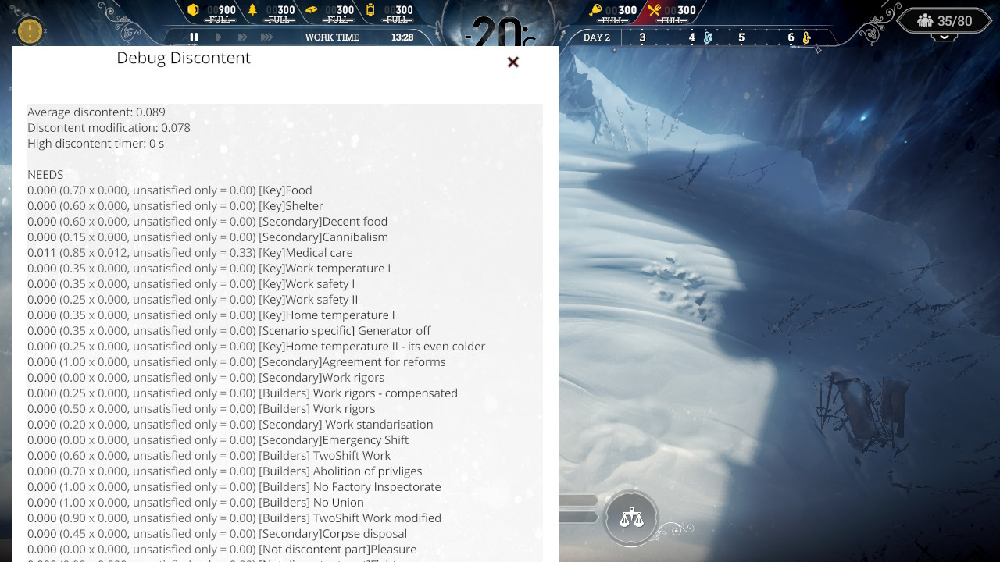
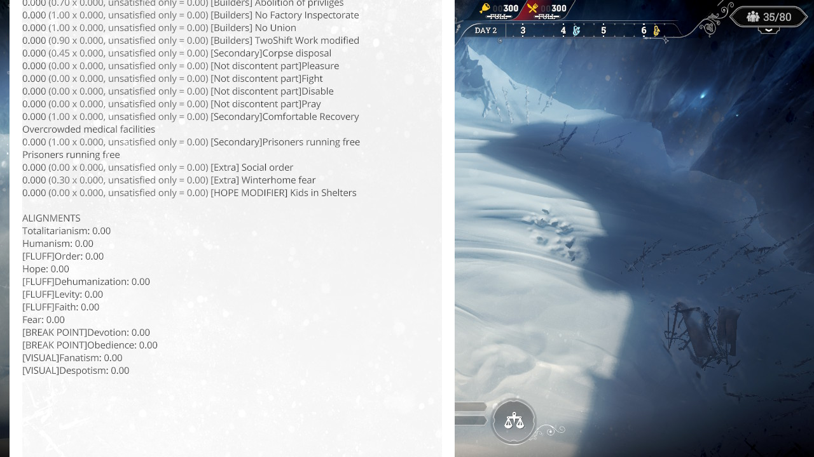

# Frostpunk -- the developers' own cheats

Frostpunk on the Switch still contains the cheat system its developers used while making the game, and their debug panels. Nothing in the game turns them on. These Breeze cheats do, through the game's own code, so the game does exactly what it did for its developers, and tells you so on screen.

| | |
|---|---|
| Game | Frostpunk 1.0.1 |
| Title ID | `0100B1C0249B4000` |
| Build ID | `E258A7371ECD2A27` |
| Breeze | **beta126.02 or later** (folders inside folders) |

## Install

Copy `E258A7371ECD2A27.txt`, `E258A7371ECD2A27.ini` and `resource full.txt` to `/switch/breeze/cheats/Frostpunk/` on your SD card, or use **Get latest cheat from TomVita** in Breeze. Then load the cheats in Breeze (Cheats > Load Cheats from file).

Everything starts switched off.

## Finding your way in the list

The cheats sit in one folder, **Developer cheats**, with four folders inside it. Press **A** on a folder to open it, and **B** to go back up. The title shows where you are.

## Step 1: turn on the engines

Open **Engines (keep on)** and turn on all four. The other cheats do nothing without them.

| Engine | Needed by |
|---|---|
| Dev cheats engine (keep on) | everything in Toggles |
| Debug panels engine A (keep on) and Debug panels engine (keep on) | everything in Panels |
| Actions engine (keep on) | everything in Actions |

A green line means the cheat is off but its hook is still in the game. Press A until the square is filled (on) and the line is white.

## Toggles: the developers' cheats

Turn one on and the game turns the matching developer cheat on; turn it off and, about two seconds later, the game turns it off again. The game shows a message each time:

| Cheat | What it does |
|---|---|
| Infinite resources | the game's own infinite resources |
| Instant construction | buildings finish at once |
| Freeze citizen statistics | citizens' state stops changing |
| Immortal citizens | nobody dies |
| No critical citizen statistic levels | no critical states |
| Valid placement everywhere | build anywhere |
| Instant research | research finishes at once |
| Resources boost | more resources |
| Freeze alignments | |
| Reset sociotech cooldown | laws can be signed again at once |
| Instant expedition travel | scouts arrive at once |
| Unlock all technologies / buildings / sociotech / unlocks | as named |
| Enable time in frostland | |
| Research all tech | as named |
| Open next dilemma | |

The descriptions are from the cheats' names; only Valid placement everywhere was checked in the game. **Unlock all ... and Research all tech stay done** once they have run, even after you turn them off, and your next save keeps them. Try them on a save you do not mind changing.

## Panels: the developers' debug screens

These open the developers' panels in the game. All of them share one key, **RS**: turn on the panel you want (just one), then press RS in the game to open it, and RS again to close it. The text is made bigger than the developers had it.

| Cheat | Shows |
|---|---|
| Cheat panel | every developer cheat with its On / Off state |
| Debug discontent | how discontent is worked out: every need, its weight, how unsatisfied it is, and the alignment values |
| Debug dilemmas list | the dilemmas |
| Debug messages list | the game's message categories |
| Debug weathers list | the weathers |
| Debug appearance | the selected citizen or building's look |
| Debug render view | renderer views |
| Debug discontent scroll | on **LS**: scrolls Debug discontent to its second page and back |

The panels only show information: their buttons cannot be pressed with the controller or the touch screen. The cheat panel's buttons are in the Actions folder instead.

## Actions: the cheat panel's buttons

Also on **RS**: turn on the one you want, then press RS once for each use.

| Cheat | Does |
|---|---|
| Warmer +10C | changes the weather to the one about 10 °C warmer |
| Colder -10C | changes the weather to the one about 10 °C colder |
| Random weather | picks a weather at random |
| Reveal sites | marks every expedition site explored |
| Unhide sites | shows every site on the map without exploring it |

The temperature changes as game time runs, not at once. Random weather can give you a storm. Reveal and Unhide cannot be undone in a save. Only Warmer and Colder were tried, and their effect on the thermometer was not seen yet.

## resource full

Tomvita's own cheat, outside the folder: keeps every resource at its storage limit.

## Why RS and not a button combination

The game reads ZL and ZR itself (they open the Command Hub), and ZL+ZR+Down opens the Ultrahand / Tesla overlay. So every panel and action uses the same key, and the cheat you turn on chooses what the key does.
