# Harvest Moon: The Winds of Anthos: give any item with Make cheat

Breeze's **Make cheat** button builds a cheat for you from a list of items. Pick an item, say how many, and choose a button combo. You get a cheat that puts that many of the item in your bag each time you press the combo. This folder holds the list for this game, 1,838 items in all: seeds, crops, fish, dishes, eggs, materials, gems and so on. Tools and key items are left out on purpose.

## What you need

- **Breeze beta125.06 or later.**
- **The game at build `A753E6CFC9A3A3D9`.** The cheats call into the game's own code, so they only work on this build.
- **These files**, copied into Breeze's folder for the game, `sdmc:/switch/breeze/cheats/Harvest Moon The Winds of Anthos/`:
  - `make_cheat.ini`: the recipe.
  - `items.tsv`: the item list.
  - `asm/Give item hook (needed by Give cheats).txt`. Put it in the game folder itself, not in an `asm` folder.
  - `A753E6CFC9A3A3D9.txt` (optional): the other cheats for this game, plus the **Give item hook** cheat.

The **Give item hook** is a small helper that hands each request to the game's own "add item to bag" code. That is the same call the game makes when you harvest. Every give cheat needs it. If it isn't loaded, Make cheat builds it from the script the first time you make a cheat.

## Step by step

### 1. Open Make cheat

Start the game, open Breeze, and go to the **Cheats** screen. Press **Make cheat** (`R + ZL`).

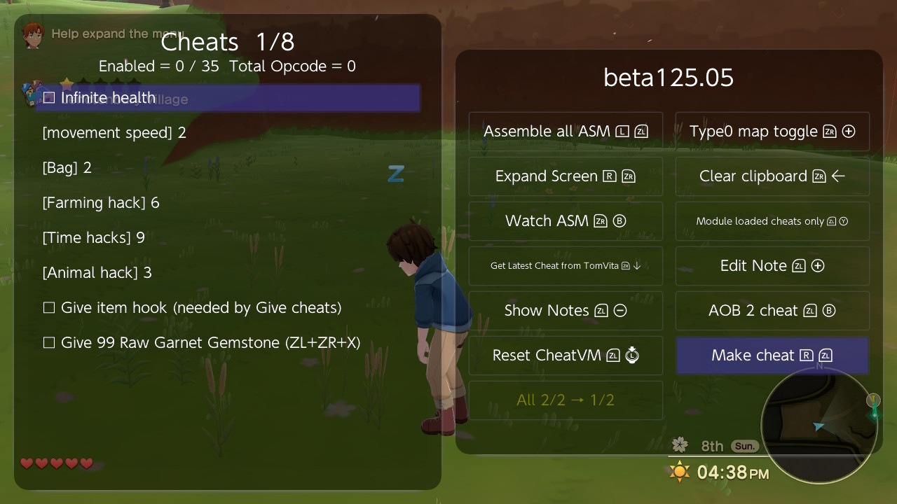

The list shows every item you can give, with its kind and its selling price. The title shows the cursor position and the number of rows. The line under the title shows how many items are shown, the filter, the search words and how many items are marked.

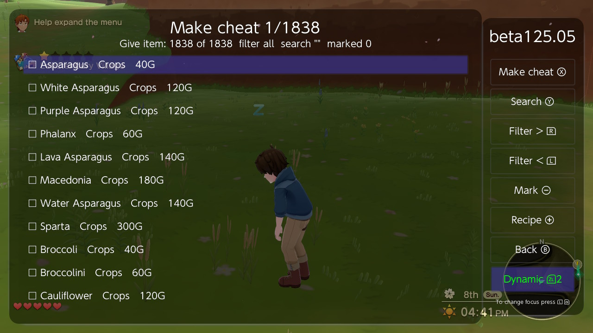

### 2. Find the item

**Search** (`Y`) and type part of the name. Every word you type must appear in the name. Search with nothing typed to see everything again.

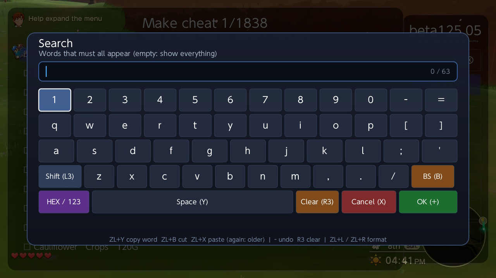

Here, `turnip` leaves 10 items:

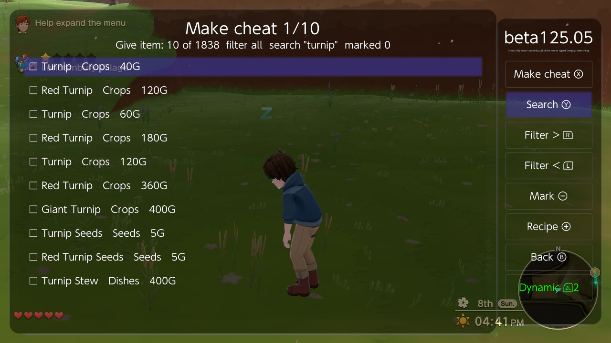

Some names appear more than once at different prices (Turnip at 40G, 60G and 120G). Those are the quality grades of the same crop. The price tells them apart.

**Filter >** (`R`) and **Filter <** (`L`) show one kind of item at a time: Seeds, Crops, Fish, Eggs and so on, then all again. The filter and the search work together. Here, Seeds plus `turnip` leaves the two kinds of turnip seed:

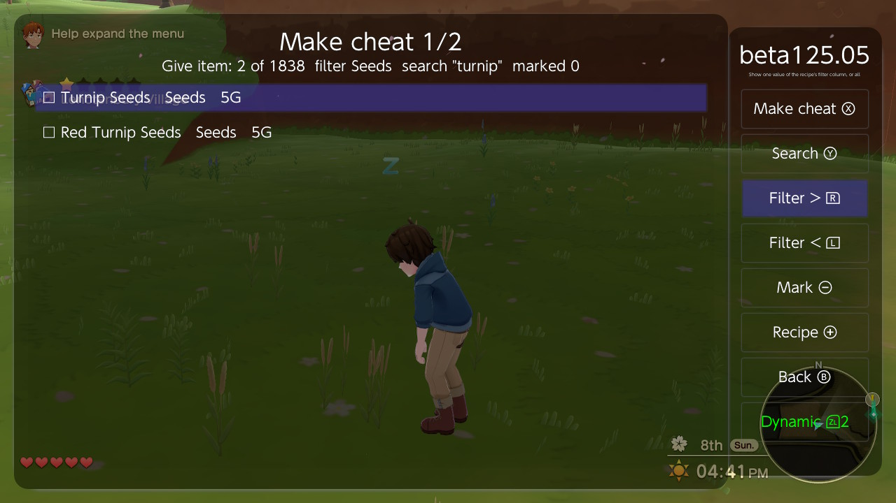

### 3. Make the cheat

Put the cursor on the item and press **Make cheat** (`X`). Breeze asks two things.

**How many** each press gives, from 1 to 999. The default is 99.

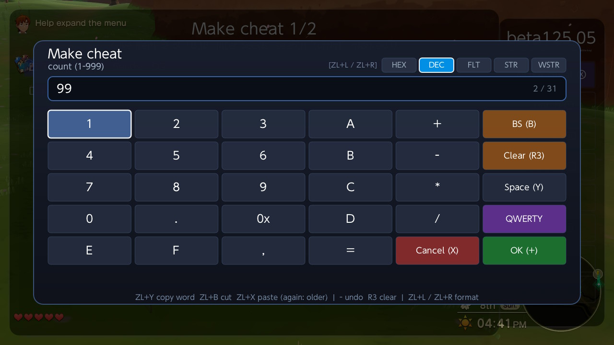

**The button combo.** Type it as button names joined by `+`, for example `ZL+ZR+Y`. The names are A B X Y L R ZL ZR LS RS PLUS MINUS UP DOWN LEFT RIGHT.

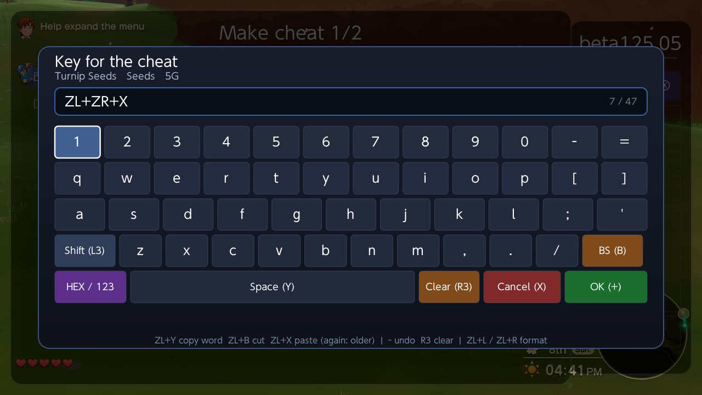

Give each cheat its own combo. Two cheats on the same combo both fire on one press. Avoid combos the game itself uses during play.

The cheat is made, switched on, and saved to the cheat file:

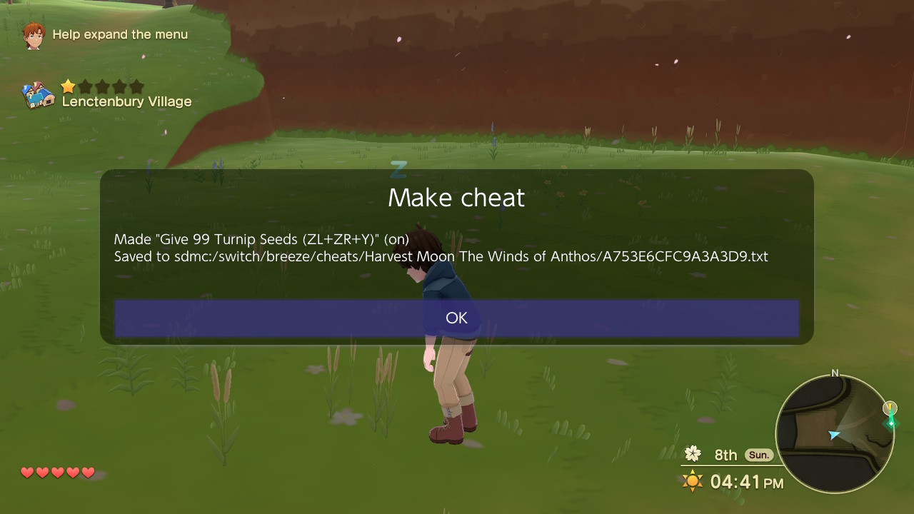

### 4. Several items at once

Press **Mark** (`-`) on each item you want. A marked row shows a filled square, and the cursor moves down one row. Then press **Make marked** (`ZL + X`). Breeze asks how many once, then a combo for each item. **Clear marks** (`ZL + -`) unmarks everything.

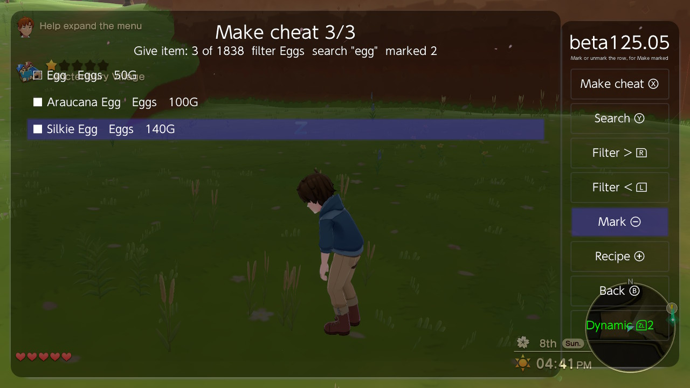

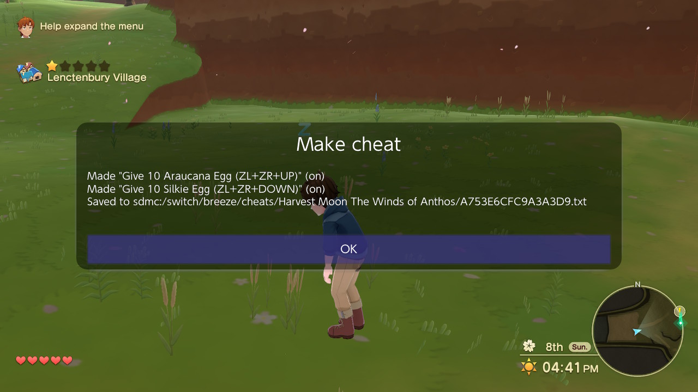

**Back** (`B`) returns to the Cheats screen. The new cheats are there and switched on, next to the **Give item hook**:

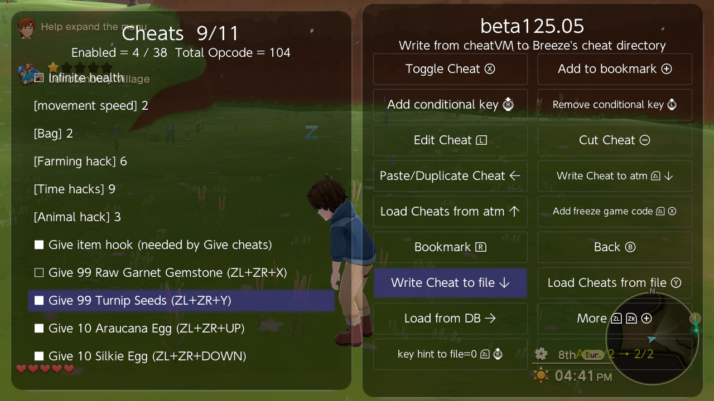

### 5. Use it in the game

Go back to the game and press the combo. Each press gives the amount once. Holding the buttons does not repeat it: let go and press again for more.

The bag before and after one press of `ZL+ZR+UP` (Give 10 Araucana Egg):

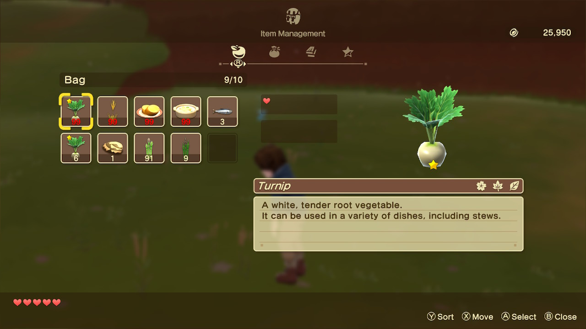

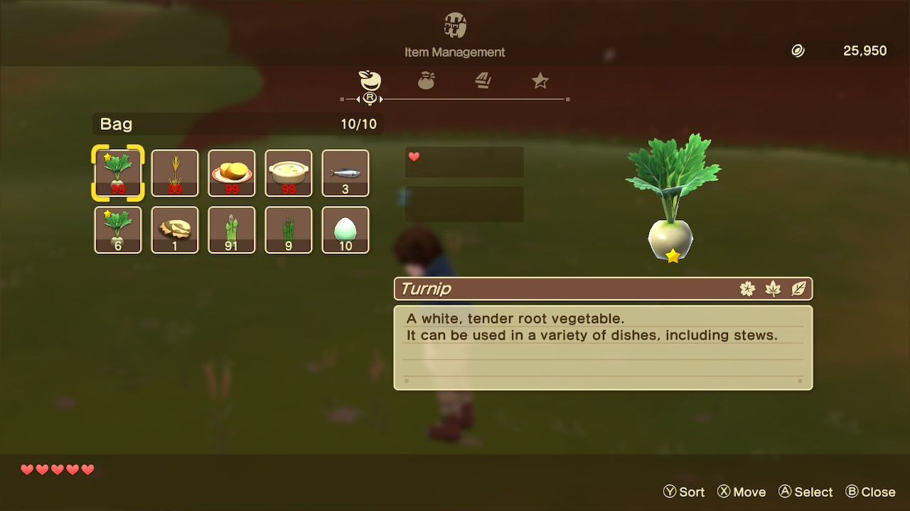

If the bag screen is open when you press the combo, the item is added but the screen doesn't change. Close the bag and open it again to see it.

## Good to know

- **Bag space.** A full stack holds 99, so a give over that starts a new stack. If the bag has no free slot, whatever doesn't fit is lost. In the shots above the eggs filled the last free slot (10/10).
- **Making it again.** A cheat with the same name replaces the old one. "Give 99 Turnip Seeds (ZL+ZR+Y)" made twice stays one cheat.
- **Removing.** Remove a give cheat like any other cheat. Keep the Give item hook while you still have give cheats.
- **Only items from the list.** The list holds the game's own item ids. A made-up id could make the game's add-item call fail and close the game.
- **Tools and key items** are not in the list. Tool levels and story items are better left to the game.

## Checked on the console

All of this was done on the Switch, on build `A753E6CFC9A3A3D9`, and every shot above is from that run:

| Step | Result |
|---|---|
| Search `turnip` | 10 of 1,838 items |
| Filter Seeds with `turnip` | 2 items |
| Make cheat, 99 Turnip Seeds on `ZL+ZR+Y` | made and switched on, cheat file saved |
| Make marked, 2 eggs, 10 each | 2 cheats made |
| One press of `ZL+ZR+Y` in the game | exactly one new stack of 99 Turnip Seeds; nothing more 2 s later |
| One press of `ZL+ZR+UP` | 10 Araucana Eggs in the bag |

## For cheat makers

`make_cheat.ini` is a plain text recipe, and `items.tsv` is a tab-separated table. The same Make cheat button works for any game that has such files. The format is described in [Make Cheat Recipes](https://github.com/tomvita/Breeze-Beta/blob/master/docs/make%20cheat%20recipes.md).
