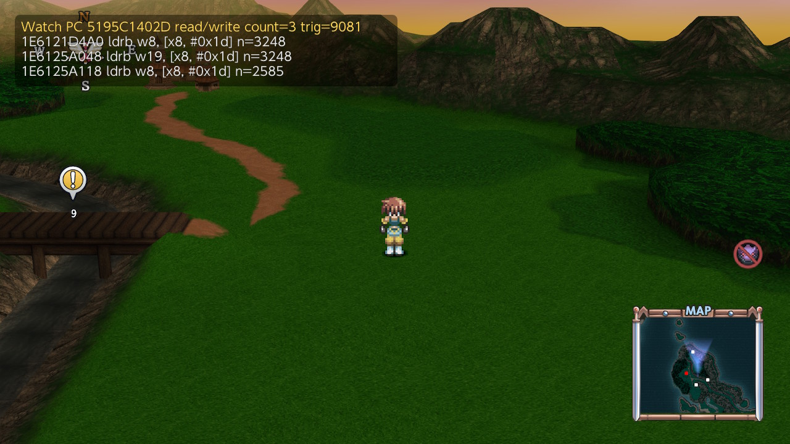
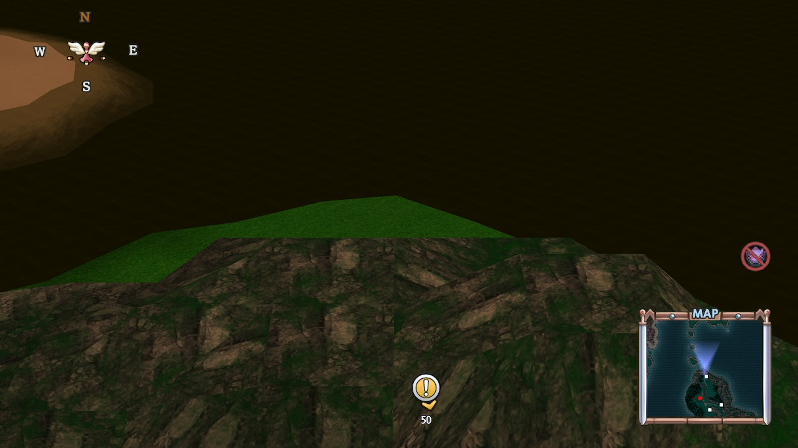
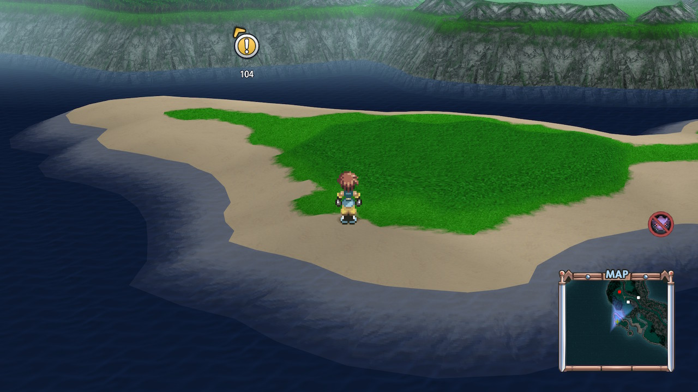

# Tales of Eternia Remastered - cheats

Version 2.0.0, title ID `010006E0230AC000`, build ID `54B55157030F6A82`.
Cheat file: [54B55157030F6A82.txt](54B55157030F6A82.txt).

The game runs in a separately loaded module (`GameNative_Release_NX64.nrs`),
not in the main executable. The `{master}` code finds that module every time
the game starts, so keep it in the file; every other cheat depends on it.
The master was made by Breeze (made after beta125.03, commit f25136c) from
pointers the system loader keeps, so it does not depend on game data.

## Battle

| Cheat | What it does |
|---|---|
| Party takes no damage | Party members lose no HP. Enemies still take damage. |
| One hit kill | Every hit on an enemy does 30000 damage. |
| Party TP not used (artes) | Artes cost the party no TP. Not seen in use yet. |
| Party TP not used (other) | A second place the game spends TP. Not seen in use yet. |

## World map

| Cheat | What it does |
|---|---|
| Encounters off | No random battles. The game shows its own "encounters off" icon. |
| Encounters fewer | The game's "fewer encounters" setting. |
| Encounters normal | The normal setting. |
| World map walk speed normal / x2 / x4 | Walk speed 10 / 20 / 40. |
| Walk through walls (world map) | Walk over mountains, rivers and river banks. |
| Walk through walls off | Puts all three changes of the cheat above back. |
| ZL+ZR: back to land (world map) | Hold ZL+ZR to return to where you stood on land a few seconds ago. |

### Things to know

- **Turn on only one encounter option and one speed option at a time.** They
  write their value every pass, so two at once fight each other.
- **The encounter setting is saved with your game.** Turning "Encounters off"
  off does not bring battles back; turn on "Encounters normal" (or set it in
  the game's options).
- **To undo walk through walls, use "Walk through walls off".** Switching the
  cheat itself off only undoes the first of its three changes.
- **The sea still blocks you, on purpose.** Letting the walker onto the sea
  crashed the game.
- **You can still walk off the coast into the water and get stuck.** Hold
  **ZL+ZR** and you are put back on land, at a spot a few seconds back on your
  path. Where exactly depends on when the cheat last noted your position, so
  it can differ each time.

Towns and dungeons were not tested with the world-map cheats.
